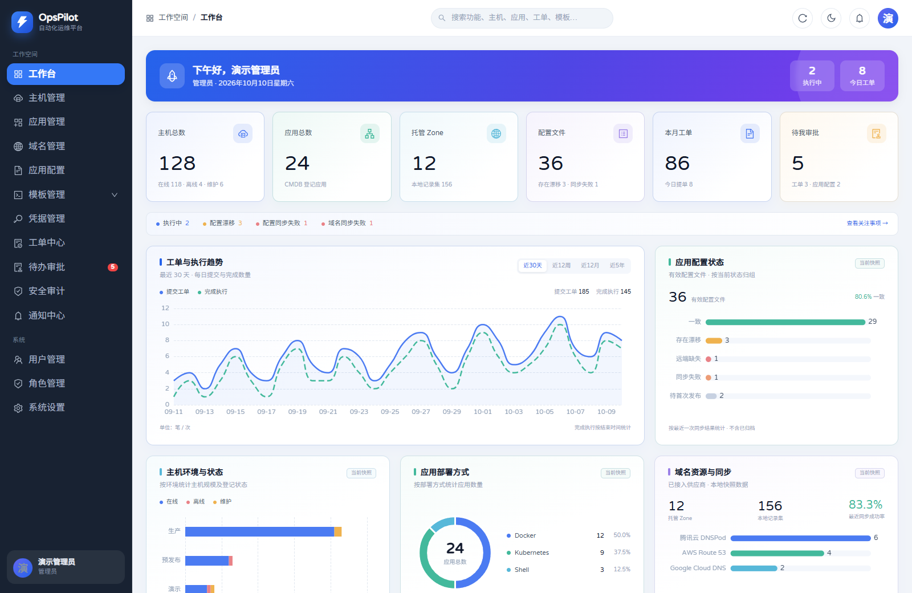
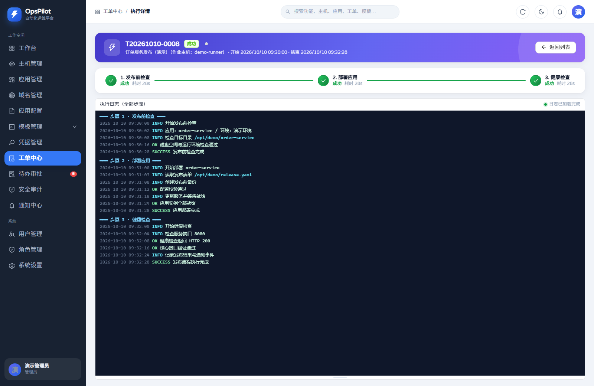

# OpsPilot

OpsPilot 是面向企业内网的自动化运维平台：CMDB 资产台账、数据库只读管理、作业主机、工单模板、可复用流程模板、审批、串行执行、实时日志、通知和审计组成完整闭环。

技术栈：FastAPI + 异步 SQLAlchemy + MySQL 8 + Redis 7 + `asyncssh`；Vue 3 + TypeScript + Ant Design Vue 4；Docker Compose 单机部署。

文档入口见 [`docs/README.md`](docs/README.md)，生产和内网部署见 [`deploy/DEPLOYMENT.md`](deploy/DEPLOYMENT.md)。

## 界面预览

以下截图展示当前系统界面，账号、资产和日志均使用演示数据；实际内容按用户权限和业务数据展示。

### 工作台 · 亮色主题

查看资产规模、工单与执行趋势、配置状态等数据概览。



### 工单执行详情

查看串行步骤的执行状态、耗时及按步骤合并的执行日志。



## 快速部署

前置条件：部署机安装 Docker Engine 24+ 和 Compose v2。在线部署不需要单独安装 Python、Node、MySQL 或 Redis。

```bash
cd deploy
cp .env.example .env
# 修改 MYSQL_ROOT_PASSWORD、MYSQL_PASSWORD、JWT_SECRET_KEY
# 生产环境同时设置 SECRET_ENCRYPT_KEY 并离线保存
docker compose up -d --build
```

启动后访问 `http://<部署机IP>:8080`，端口由 `NGINX_HTTP_PORT` 控制。Compose 启动六个服务：`nginx`、`api`、`worker`、`database-executor`、`mysql`、`redis`。只有 Nginx 暴露宿主机端口；数据库执行器独立访问登记的目标库，不复用工单 Worker。

API 容器启动时执行 `alembic upgrade head` 并幂等初始化权限、内置角色、初始 admin、系统配置和通知默认映射。`ADMIN_INITIAL_PASSWORD` 为空时随机生成密码并写入 API 日志；首次登录必须修改密码并按策略完成 MFA。

## 首次使用

1. 系统配置中创建 SSH 凭据。
2. 创建作业主机并绑定凭据，测试连通性。
3. 在 CMDB 维护主机和应用资产。
4. 创建流程模板，配置 Shell/Playbook 步骤、步骤超时、失败策略和步骤前审批角色。
5. 创建工单模板，绑定作业主机和流程模板，配置参数、动态生成脚本、通知规则和可见角色。
6. 配置邮件、Webhook 或 Teams 渠道及事件映射。
7. 选择启用的工单模板提交，按流程审批，观察执行日志和通知记录。

数据库管理可独立使用：准备受限只读用户名密码凭据，登记 MySQL/PostgreSQL/MongoDB/ClickHouse/Redis 实例并关联应用和承载主机，再显式给角色授权实例。管理员查询也需要实例授权；工作台只读、结果不导出，执行记录进入独立审计。目标连接/取消权限和部署边界见[数据库管理运行说明](deploy/DEPLOYMENT.md#12-数据库管理运行与目标权限)。

## 常用运维命令

```bash
cd deploy
docker compose ps
docker logs -f opspilot-api
docker logs -f opspilot-worker
docker compose logs -f database-executor
docker compose down                 # 保留数据卷
docker compose up -d
curl -s http://localhost:8080/healthz
curl -s http://localhost:8080/api/v1/ping
```

备份数据库和执行日志：

```bash
bash scripts/backup.sh
```

备份产物位于 `deploy/backup/<时间戳>/`，MySQL全库包含数据库台账、任务、短期加密结果与独立审计。脚本不包含Redis临时认证/控制状态或加密主密钥，恢复边界见[部署手册](deploy/DEPLOYMENT.md#8-备份与恢复)。

## 离线部署

在可联网构建机执行：

```bash
cd deploy
bash scripts/export_images.sh export
```

将生成的 `offline/opspilot_images.tar.gz` 和整个 `deploy/` 目录复制到内网部署机，执行：

```bash
cd deploy
bash scripts/export_images.sh import
cp .env.example .env
# 修改密钥
docker compose up -d
```

## 目录

应用配置通过独立主菜单维护生产配置文件，支持 Apollo、Nacos、Consul 的 HTTP 接入、版本审批、手动同步及漂移处理。配置文件与 CMDB 应用可多对多关联；仅删除本地归档记录，不删除远端配置。平台真实版本联调状态见[兼容性记录](docs/应用配置平台兼容性记录.md)。

数据库管理包含实例台账、只读查询、执行历史和独立审计；启动与验证步骤见[开发验收 §5](docs/05-开发与验收指南.md#5-数据库管理开发与验收)。目标数据库须单独准备受限账号；直连容器验收不代表云代理、TLS或其他版本已经兼容。

```text
backend/  FastAPI API、数据库模型、迁移、Worker 和独立数据库执行器
frontend/ Vue 3 单页应用，构建后由 Nginx 提供静态资源
deploy/   Compose、Nginx、初始化 SQL、备份和离线镜像脚本
docs/     产品、架构、数据库、API、功能说明与开发验收指南
```
