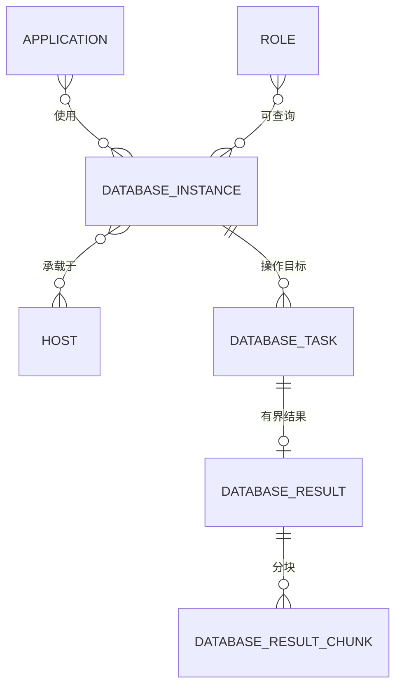

# OpsPilot 数据库设计

| 项目 | 内容 |
| --- | --- |
| 文档定位 | 当前 ORM 与迁移参考 |
| 数据库 | MySQL 8.0，`opspilot`，`utf8mb4` / `utf8mb4_0900_ai_ci`，InnoDB |
| 表数量 | 48 张业务表；以 `backend/app/models/` 和 Alembic `head` 为准 |

本文包含数据库管理九表，详见[第 11 章](#11-数据库管理)；模型已注册，迁移 head 为0027。表数量不表示已有部署均已完成升级。

## 1. 设计约定

- 主键统一为 `BIGINT UNSIGNED AUTO_INCREMENT`；表名使用蛇形单数。
- 外键关系由应用层校验，不创建物理外键；关联字段建立索引。
- 枚举使用 `VARCHAR`，由 `backend/app/core/constants.py` 管理。
- 通用时间字段使用 `DATETIME(3)`；快照和日志表不添加无意义的更新时间。
- 敏感字段以 `_enc` 命名，保存 AES-256-GCM 密文；快照不保存凭据密文。
- 用户使用 `status=disabled` 逻辑禁用；其他业务资源使用物理删除和应用层删除保护。

## 2. 表清单和关系

```text
user ─< user_role >─ role ─< role_permission >─ permission
  └─< api_token

host ─< app_host >─ application
application ─< ticket_template_application >─ ticket_template
application ─< config_file_application >─ config_file
application ─< database_instance_application >─ database_instance
host ─< database_instance_host >─ database_instance
role ─< database_role_instance >─ database_instance
credential ─< database_instance
database_task ─< database_result ─< database_result_chunk
database_audit_event / database_quota_bucket

credential ─< job_host ─< ticket_template ─< ticket
credential ─< dns_zone ─< dns_record_set
dns_zone_bind_task ─< dns_zone_bind_task_item
process_template ─< process_step
process_template ─< ticket_template
ticket_template ─< ticket_parameter_prepare
ticket ─< ticket_step ─< execution_step
ticket ─< ticket_approval
ticket ─< execution ─< execution_step

credential ─< config_platform_instance ─< config_file
config_file ─< config_draft / config_version / config_remote_snapshot
config_file ─< config_task ─< config_task_item

notify_channel ─< notify_channel_event
notification_record
user_notification
audit_log
system_config
```

上述关系由应用层维护，不代表物理外键；发现接入任务创建时可尚未关联配置文件。当前 48 张业务表按领域划分如下，Alembic 自身版本表不计入。

| 领域 | 数量 | 表 |
| --- | --- | --- |
| 认证与 RBAC | 6 | `user`、`role`、`permission`、`user_role`、`role_permission`、`api_token` |
| CMDB | 3 | `host`、`application`、`app_host` |
| 凭据与作业主机 | 2 | `credential`、`job_host` |
| 域名管理 | 4 | `dns_zone`、`dns_record_set`、`dns_zone_bind_task`、`dns_zone_bind_task_item` |
| 模板 | 4 | `ticket_template`、`ticket_template_application`、`process_template`、`process_step` |
| 工单 | 4 | `ticket`、`ticket_step`、`ticket_approval`、`ticket_parameter_prepare` |
| 执行 | 2 | `execution`、`execution_step` |
| 通知 | 4 | `notify_channel`、`notify_channel_event`、`notification_record`、`user_notification` |
| 审计与系统配置 | 2 | `audit_log`、`system_config` |
| 数据库管理 | 9 | `database_instance`、`database_instance_application`、`database_instance_host`、`database_role_instance`、`database_task`、`database_result`、`database_result_chunk`、`database_audit_event`、`database_quota_bucket` |
| 应用配置 | 8 | `config_platform_instance`、`config_file`、`config_file_application`、`config_draft`、`config_version`、`config_remote_snapshot`、`config_task`、`config_task_item` |

## 3. 认证与 RBAC

### 3.1 `user`

`username` 唯一；`source` 为 `local`、`ldap` 或 `oidc`；本地用户有 bcrypt `password_hash`，外部用户可为空。`email` 用于通知和密码重置。`mfa_secret_enc` 保存 TOTP 密钥密文；`must_change_password` 用于初始密码和密码重置后的强制改密；`locked_until` 保存登录锁定截止时间。

### 3.2 `role`、`permission`

`role.code` 唯一，内置角色通过 `is_builtin` 标记。`permission.code` 唯一，启动种子按代码常量同步 [46 个权限点](./04-API设计.md#12-权限点全集)，其中数据库管理新增 read、write、delete、grant、query、audit 六项。功能权限之外，`database_role_instance` 单独保存显式实例查询授权。

### 3.3 `user_role`、`role_permission`

两张关联表分别约束用户-角色和角色-权限的唯一组合，并为反向查询建立索引。权限取用户全部角色的并集。

### 3.4 `api_token`

保存个人访问密钥的名称、前缀、SHA-256、过期时间、最后使用时间和创建时间。明文只在创建响应返回一次；每人最多 10 个。

## 4. CMDB 与作业资源

### 4.1 `host`

保存 CMDB 主机名、唯一内网 IP、可选公网 IP、项目（`mitrade` / `tradingkey`）、RI、主机系列、平台、区域、操作系统、CPU、内存、磁盘、环境、状态、SSH 端口和说明。此表是资产台账，不保存 SSH 密码或私钥。

### 4.2 `application`、`app_host`

`application` 保存名称、说明、语言、部署方式、项目类型（`frontend` / `backend`，默认 `frontend`）、所属业务线（`mitrade` / `tradingkey`，默认 `mitrade`）、所属系统、服务级别（“核心服务” / “一般服务”，默认“核心服务”）、运维负责人、开发负责人、代码仓库地址、服务端口、CPU 配额和 MEM 配额；项目类型、所属业务线和服务级别为枚举，其余新增台账字段可空。`app_host` 保存应用与主机的多对多关系，组合唯一。

### 4.3 `credential`

保存凭据名称、可空登录用户、认证类型、`secret_enc`、可选 `passphrase_enc`、文本密钥文件名和描述。认证类型为 `password`、`private_key`、`api_token`、`username_password` 或 `secret_file`；`secret_file` 的 UTF-8 内容最大 128 KiB。明文只在创建/更新请求中出现，任何读取接口不回显。SSH 凭据被作业主机引用、脚本密钥被工单模板或活动工单引用时不能删除。

### 4.4 `job_host`

保存作业主机名称、IP、SSH 端口、`credential_id`、工作目录、启用状态和最近连通性测试结果。`(ip, ssh_port)` 唯一；模板引用的作业主机不能删除。

### 4.5 `dns_zone`

保存公网 Zone 台账和同步状态。`(provider, remote_zone_id)` 唯一，`credential_id` 与 `created_by` 仅保存 ID、不建立物理外键；`credential_id` 和 `sync_status` 建索引。核心字段包括 `provider`、`remote_zone_id`、`zone_name`、`description`、`record_count`、`last_synced_at`、`last_sync_error`，以及用于串行化远端操作的 `operation_token`、`operation_kind`、`operation_expires_at`。Zone 绑定任务首次读取失败时保留 `record_count=0`、`sync_status=failed` 的空快照和错误摘要。凭据认证内容不进入本表。

### 4.6 `dns_record_set`

保存归一化的 DNS 记录集快照。`(zone_id, record_key)` 唯一，`zone_id` 以及 `(zone_id, record_name, record_type)` 建索引；不创建对 `dns_zone` 的物理外键。记录保存名称、类型、TTL、值数组、只读标记和原因，以及只供服务端定位的 `record_key`、`provider_meta`。解绑 Zone 时由应用层先删除关联记录快照。

### 4.7 `dns_zone_bind_task`

保存异步 Zone 绑定任务。状态为 `queued`、`running`、`success`、`partial_failed` 或 `failed`；按 `(status, created_at)` 和 `created_by` 建索引。任务保存服务商、凭据 ID、总数与成功/跳过/失败计数、最后错误、操作人审计信息及任务租约，不保存凭据明文。租约到期的 `running` 任务可由 Worker 重新认领。

### 4.8 `dns_zone_bind_task_item`

保存任务内每个远端 Zone 的处理状态。`(task_id, remote_zone_id)` 唯一，`(task_id, status)` 建索引；不创建物理外键。子项保存 Zone 名称、本地 Zone ID、说明、失败原因和任务租约认领令牌，状态为 `pending`、`running`、`success`、`skipped` 或 `failed`，使 Worker 重启后能够继续未完成项。

## 5. 模板与工单

### 5.1 `ticket_template`

保存工单入口：

| 字段 | 说明 |
| --- | --- |
| `name` | 唯一名称 |
| `type` | `release` / `daily_ops` / `other` |
| `job_host_id` | 单个作业主机 |
| `process_template_id` | 单个流程模板 |
| `params_schema` | JSON 参数定义 |
| `generator_script` / `generator_timeout` | 动态参数生成 |
| `credential_refs` | JSON 脚本密钥引用 `[{alias, credential_id}]` |
| `allow_withdraw` | 审批中是否允许创建人撤回 |
| `concurrency_control_enabled` | 是否启用同模板并发控制，默认关闭 |
| `active_execution_id` | 并发控制当前占用的执行实例；仅该执行实例的终态可清除 |
| `notify_rules` | 事件、收件人和渠道数组 |
| `visible_role_ids` | 可见角色数组；空数组为全部 |
| `status` | `enabled` / `disabled` |

#### 5.1.1 `ticket_template_application`

`ticket_template_application` 保存模板适用应用的多对多关联：`id`、`template_id`、`app_id`、`created_at`；`(template_id, app_id)` 组合唯一，`app_id` 有反查索引。迁移 `0025` 新建空关联表，旧模板默认未绑定应用。删除模板或应用时在同一事务清理关联，不删除另一端对象。该关系仅为适用范围台账，不参与工单参数、快照或执行目标计算。

### 5.2 `process_template`

保存流程名称、说明、状态和 `exec_strategy` JSON。执行策略字段为 `timeout`、`fail_fast`、`kill_on_stop`。

### 5.3 `process_step`

保存流程步骤顺序、名称、脚本类型、脚本内容、超时和可选 `approval_role_id`。同一流程的 `step_order` 唯一，每步最多一个审批角色。

### 5.4 `ticket`

保存工单编号、模板 ID、标题、类型、参数、作业主机快照、流程模板 ID/名称快照、状态、执行策略快照、流程快照、撤回开关、当前步骤、创建人和时间。

工单编号由[工单服务](../backend/app/services/ticket_service.py)生成，格式为 `T{YYYYMMDD}-NNNN`，四位日内序号从 1 递增，`ticket_no` 上有唯一约束。取号是“先查当日最大编号、再在应用侧加一”，没有计数器行、锁或唯一键重试，因此并发提交可能算出同一编号并以未处理的主键冲突失败；日内序号超过 9999 后，字符串倒序会把四位编号排在五位编号之前，序号无法继续正确递增。不能把它描述成并发安全或无上限的连续编号。

状态枚举为：

```text
approving queued running paused success failed rejected cancelled interrupted
```

`interrupt_reason` 保存 `user_abort`、`system_crash` 或 `worker_lost`。

### 5.5 `ticket_step`

保存工单提交时固化的步骤名称、脚本类型、脚本内容、参数、超时和审批角色快照。执行和详情只读取此表，不重新读取模板。

### 5.6 `ticket_approval`

保存工单步骤、审批角色、审批人、动作（`approve`/`reject`）、意见和时间。角色内任一成员完成动作即可推进；驳回终止工单。

### 5.7 `ticket_parameter_prepare`

保存动态参数预生成令牌、模板 ID、提交前参数、生成值、候选项、过期时间、消费时间和创建时间。服务检查消费标记，但当前未以条件更新或行锁保证并发单次消费，也未比较原始输入与提交输入；字段存在不构成这些行为的保证，见[预生成边界](./06-模板管理与流程模板设计.md#42-动态参数预生成)。

## 6. 执行

### 6.1 `execution`

一个工单对应一个执行实例，保存工单 ID、状态、步骤总数和开始/结束时间。状态包括 `queued`、`running`、`paused`、`success`、`failed`、`terminated`、`interrupted`、`rejected`、`cancelled`。

### 6.2 `execution_step`

保存执行实例、工单步骤、步骤顺序、状态、退出码、失败摘要和开始/结束时间。步骤状态包括 `pending`、`running`、`success`、`failed`、`timeout`、`skipped`、`terminated`。这是模型可表达的状态集合；当前作业主机 runner 超时返回 `failed` 与超时摘要，`fail_fast` 停止后也不统一把后续步骤写为 `skipped`，见[执行引擎行为](./02-技术架构设计.md#6-worker-执行引擎)。

## 7. 通知

### 7.1 `notify_channel`

每种渠道一行，保存类型、启用状态、非敏感 `config`、敏感 `secret_enc` 和更新时间。当前启用能力为 Email、Webhook、Teams。

### 7.2 `notify_channel_event`

以 `(event, channel_type)` 唯一，表示某事件启用的发送渠道。事件包括待审批、审批通过、审批驳回、执行成功、执行失败和执行中断。

### 7.3 `notification_record`

保存事件、渠道、收件人摘要、渲染后的标题/正文、关联对象、状态、重试次数、下次重试时间、错误和发送时间。状态包括 `pending`、`sending`、`success`、`failed`。

### 7.4 `user_notification`

按用户保存站内信事件、标题、正文、关联对象、已读标记和读取时间。站内信不参与外部渠道重试。

## 8. 审计与系统配置

### 8.1 `audit_log`

保存时间、操作人、来源 IP、模块、动作、目标对象、结果和 JSON 详情。表按月 RANGE 分区，只追加和查询；Worker 按 `AUDIT_RETENTION_DAYS` 清理过期分区。审计导出自身也记录一条审计。

### 8.2 `system_config`

保存预置配置键和值。当前键包括：

| 键 | 作用 |
| --- | --- |
| `mfa.policy` | `off` / `optional` / `required` |
| `token.policy` | `session_hours`：单次登录会话最长时长（1-168 小时，默认 8）；旧 Access/Refresh 时长字段读取时忽略 |
| `password.policy` | 密码复杂度、失败锁定和公开策略 |
| `ldap.config` | LDAP 连接配置，敏感字段读取时掩码 |
| `oidc.config` | OIDC 连接配置，敏感字段读取时掩码 |
| `ldap.default_role` / `oidc.default_role` | SSO 首次登录默认角色 |
| `exec.global_concurrency` | 保留的全局并发配置键，当前 Worker 未消费，不代表生效的限流 |

## 9. 初始化和迁移

API 容器启动时先尝试执行 Alembic `upgrade head`（应用配置初始迁移为 `0021`，当前 head 为 `0026`，新增数据库管理九表），迁移成功后再启动 API，依次同步权限、内置角色、admin、系统配置和通知默认映射。种子操作使用 MySQL `GET_LOCK` 串行化并可重复执行。

当前 `0001` 仍依赖最新 ORM 建表；`0022` 至 `0024` 已增加字段存在性检查，`0026` 使用冻结DDL并逐表核对已有结构。`0010` 包含历史业务表删除重建，不能视为无损升级。空库安装与旧库升级分别验证，不能仅凭当前 ORM 结构宣称成功，具体限制见[迁移验收](./05-开发与验收指南.md#33-迁移与清理)。

数据模型的事实来源是 `backend/app/models/` 和 `backend/alembic/versions/`；新增字段或表必须同时新增迁移并更新本文档。

## 10. 应用配置数据

| 表 | 用途与关键约束 |
| --- | --- |
| `config_platform_instance` | 平台、Base URL 与凭据 ID；首次绑定后锁定平台与地址，停用且无引用才可删除 |
| `config_file` | 精确远端定位器；规范化定位器的 SHA-256 摘要作 `locator_key`，`(platform_instance_id, locator_key)` 唯一，记录审批角色、正式基线、最新快照、归档与漂移状态 |
| `config_file_application` | 与 CMDB 应用多对多关联，`(config_file_id, application_id)` 唯一，不授予权限 |
| `config_draft` | 每配置文件至多一份草稿，正文加密，保存所基于的版本与快照 |
| `config_version` | 冻结候选及正式版本，`(config_file_id, version_no)` 唯一；审批角色、提交人与来源随版本留存；`base_version_id` 保存生成时的当前正式版本，无旧正式版本时为空，用于历史与审批差异对照 |
| `config_remote_snapshot` | 加密外部快照及存在状态、读取时间和远端修订标识 |
| `config_task` | 接入、手动同步、发布的状态、租约及脱敏结果；发布任务以 `retry_count`、`next_attempt_at` 持久化暂时性故障的重试进度，不保存凭据或正文 |
| `config_task_item` | 多选接入的逐项结果与租约，同任务下定位器摘要 `item_key` 唯一 |

正文和快照采用字段加密，删除配置文件前必须先归档；本地删除会清理草稿、版本、快照和关联，不调用外部删除。持久化任务仅保留不含正文的结果摘要。

## 11. 数据库管理

以下对应当前 ORM 和0026冻结迁移；已有部署是否升级以现场 Alembic 版本为准。产品范围见 [PRD 第 8 章](./01-产品需求文档PRD.md#8-数据库管理)，执行状态和预算见[架构第 14 章](./02-技术架构设计.md#14-数据库管理)，接口字段见 [API 第 14 章](./04-API设计.md#14-数据库管理)。

### 11.1 关系与数据归属



关联均由应用层维护，不新增物理外键。应用—实例—CMDB 承载主机是两组独立多对多关系；现有 `app_host` 继续表达应用部署关系。云数据库允许没有 CMDB 主机。实例内部的 Database、Schema、Collection、表及 Redis DB 编号只作为运行上下文，不建立库级业务关联或平台授权表。

角色显式授权实例，多角色取并集；应用关联变化不产生授权。绑定只读账号决定实例内实际范围。查询历史由 `database_task` 承担；审计独立保存，不依赖任务行或结果块存续。

### 11.2 表和关键索引

九张表定义位于 `backend/app/models/database_management.py`；0026包含冻结DDL，逐表核对结构。下表概述职责，完整类型和索引以源码为准。

| 表 | 关键字段与用途 | 唯一性和索引要求 |
| --- | --- | --- |
| `database_instance` | 名称、`engine`、环境、描述、启用状态；`host`、`port`、默认上下文、TLS 和引擎参数白名单；可空 `credential_id`；`business_line`、`cluster_name`、`cluster_role`、`version`；`connection_options`、`concurrency_limit`；`config_revision`；最近探测摘要、创建及更新时间 | 凭据引用、引擎、环境和启用状态索引；入口不携带密码，不以地址或集群名称相同推断业务上是同一实例 |
| `database_instance_application` | `instance_id`、`app_id`、创建时间 | `(instance_id, app_id)` 唯一，`app_id` 反查索引 |
| `database_instance_host` | `instance_id`、`host_id`、创建时间 | `(instance_id, host_id)` 唯一，`host_id` 反查索引 |
| `database_role_instance` | `role_id`、`instance_id`、授权人和时间 | `(role_id, instance_id)` 唯一，`instance_id` 反查索引 |
| `database_task` | 所有者、来源 IP、`kind`、状态、上下文；原提交与实际操作密文；实例及账号身份快照、策略快照；排队/执行截止时间、开始与结束时间；执行器、租约 token、心跳；目标操作标识、停止原因及确认依据；一次性结算标记、结果和错误摘要 | `(status, created_at)` 认领索引；所有者/时间、实例/状态、租约到期及 `finished_at` 清理索引；状态回写须核对 token 与原状态 |
| `database_result` | 任务定位值、所有者、ready 状态、加密 manifest、列与类型元信息、返回行数/字节数、截断原因、完成/到期时间、密文计费及预留依据 | 每任务至多一份；到期、ready 和所有者查询索引；结果到期立即拒读，不等待物理清理 |
| `database_result_chunk` | 结果定位值、块序号、起始行号、行数、加密行数据、密文载荷大小 | `(result_id, chunk_no)` 唯一，结果/行区间分页索引；块内不重复保存列定义 |
| `database_audit_event` | `task_id` 历史定位值、事件类型和时间；操作人/来源/目标/执行身份独立快照；输入范围内的原提交及实际操作密文、校验/过程/终态依据；仅含有界结果摘要 | (task_id,id)、(task_id,event_type)、terminal_at、操作人/创建时间、实例/创建时间索引；无任务删除级联依赖，审计不能通过结果引用补齐事实 |
| `database_quota_bucket` | `scope`、`scope_key`、活动/排队计量、结果预留及密文载荷计量、目标/控制 socket 成本；owner、token、到期时间、心跳 | `(scope, scope_key)` 唯一；global/instance/user 管额度，executor 管含空闲期的心跳，maintenance 管维护租约；control 按任务记录控制租约、token与实际socket成本 |

实例仅保留可空 String(16) 的 `business_line`（当前候选 mitrade/tradingkey），不新增实例所属系统、运维负责人、开发负责人字段。`cluster_name` 和 `version` 为可空 String(128)，`cluster_role` 为可空 String(64)，空白文本归一为 null；均为人工登记的普通台账文本，不新增集群表、角色枚举或拓扑关系，不以检测值自动覆盖登记版本。应用关联变更不覆盖这些字段，角色授权单独保存，不混入实例普通更新；只改这些登记字段不递增连接 `config_revision`。

Excel 仅写名称、引擎、地址、端口、环境、描述、业务线及三项集群/版本登记字段。新名称创建为 `credential_id=NULL` 且 `enabled=false` 的待配置实例；已有名称更新时保留凭据、启停、连接选项、关联、授权和探测字段。无凭据实例不能启用或发起目标访问，补齐兼容凭据后可在编辑页启用。`database_task.credential_id` 允许空值，仅用于尚未访问目标便拒绝的任务，实际执行的任务仍有凭据身份快照。

列表按 [PRD §8.5](./01-产品需求文档PRD.md#85-页面与核心交互) 的 12 个业务列输出，复用现有 host/port 显示连接地址，无新增表或迁移。关键词覆盖非时间展示值，包括地址、端口、`host:port`（IPv6 为 `[host]:port`）、关联名称及启用/检测中文文案。关联搜索使用 EXISTS 等方式保持每实例一行，匹配先于计数/分页，不搜索其余隐藏连接参数或秘密；不为本轮增加全文检索组件。

### 11.3 快照、凭据和删除保护

提交时保存实例 `config_revision`、入口/引擎/环境快照，以及凭据 ID、更新时间和账号名称，不复制口令。排队期间配置或凭据身份变化，以 `instance_changed` 记录未执行，不能悄悄切换目标。执行时再核对用户、按任务种类所需权限和实例状态；probe 仅使用维护权限做连接与认证检测，固定 SELECT 1 或 ping，不设置或校验只读，不能执行用户操作或获得业务结果。新 probe 摘要及提示按[API 契约](./04-API设计.md#143-严格请求与响应)写入，既有历史记录不清洗。

复用现有 `credential` 的 `username_password` 类型与 `encrypt_text`。兼容选项仅返回安全引用摘要，凭据维护继续使用 `secret:*` 权限。Redis 适配器区分仅口令与 ACL 认证，展示用户名不强制转为网络协议用户名。实例及活动/恢复任务引用的凭据受到删除保护。

实例停用且没有 queued/running/stopping/recovering 任务才可删除；在同一事务清理其应用、主机、角色关联后删除实例，有角色授权不额外阻止删除，清理这些关系不额外要求 `database:grant`。删除条件校验和提交需与任务提交的实例有效性校验及入队原子协调，保证删除成功后不再为该实例接受新任务，不改变既有额度锁序；不自动取消任务以满足删除条件。批量删除逐实例执行相同保护和事务，单项失败不回滚其他已成功项。删除应用、主机、角色只清理对应关联，不删除另一端实例。历史、结果和审计依靠当时快照和所有者字段追溯，不因实例改名、授权变化或关联删除改写原事实。访问结果仍需检查当前权限，快照本身不授予查询资格。

原提交、实际操作和短期结果使用 `_enc` 字段存储。输入工程上限为 65536 个 UTF-8 字节，超长输入拒绝且仅记录长度、摘要及正文未留存原因。审计不保存口令、密钥或结果集，普通日志不输出操作原文与结果内容。

### 11.4 结果表示、计量和发布

结果采用有序 `columns: [{ordinal, name, type}]` 与二维 `rows`，重名列通过 `ordinal` 区分。大整数、Decimal、日期/时区、二进制和非有限浮点值先做明确类型的无损规范化，不按列名构建会覆盖值的对象。

输出大小只计 `canonical JSON({columns, rows})` 的 UTF-8 字节，使用 `ensure_ascii=False`、紧凑分隔符、`allow_nan=False`；`returned_bytes` 等摘要置于包外，不计 HTTP 外壳、gzip 或密文膨胀。分页返回 `saved_total`，表示保存的记录数，不是目标表总行数。

分块目标为 256 KiB，只含行数据；manifest 保存一次列定义。按行数和规范化字节数限制边读边写，单个大值及元数据也受控；驱动内部可能先缓冲整个字段/文档，真实内存边界另按[架构约束](./02-技术架构设计.md#14-数据库管理)和[验收计划](./05-开发与验收指南.md#5-数据库管理开发与验收)验证，不能用输出 5 MiB 推断进程内存只占 5 MiB。

执行前按 `2 * max_result_bytes + 65536` 保守预留；摘要最大 64 KiB，完成后按实际加密 manifest/chunks/有界摘要收缩计费。工程起点为 1 GiB 加密载荷预算，不是整个 MySQL 的磁盘上限。编码、分块和 AESGCM/base64 膨胀需证明在预留内；预算不足继续有界排队，不删除未到期结果腾空间。

只有全部块写完、计量完成后才原子发布 ready。未 ready、非本人、无当前授权或过期结果不可读；probe 仅读本人且当前维护权限允许的安全探测摘要。翻页不连接目标数据库，不重新执行。失败与过期回收必须幂等，历史/审计/索引物理占用另计。

### 11.5 独立保留和清理依据

六项业务默认值和配置范围统一维护在 [API 配置契约](./04-API设计.md#14-数据库管理)：执行 60 秒、最多 1000 条/5 MiB、结果 30 分钟、历史 30 天、审计 90 天。结果、历史、审计各自清理，通用审计的既有默认 365 天不受影响。

结果期限从完成时按执行策略快照计算，到期立即拒读。历史按 `finished_at` 加当前保留期过滤；活动或恢复任务持续可见。历史到期但仍有未过期结果或恢复依据时，延迟物理删除任务行，不让历史周期提前销毁结果。

审计按操作事件组、以审计中独立保存的确认终态时间整体过期，拒绝/排队过期用各自终态时间。未终态组持续保留，不能按每条事件 `created_at` 逐行删除而丢失最初提交和开始证据。审计保留期允许短于或长于历史，不依赖任务行存在；删除任务不能级联删审计。

配额回收必须匹配租约 token、一次性结算标记和可信目标结束依据。租约过期不是目标停止证明；`stopping`/`recovering` 的任务、审计及额度依据不得被普通过期清理移除。维护扫描通过共享短租约串行执行，批量删除并记录安全计量。

### 11.6 迁移边界

模型已在 `models/__init__.py` 注册，`0026_database_management.py` 的 down_revision=0025。迁移不导入将来会变化的 ORM，而使用冻结DDL；逐表核对字段类型/可空性、主键、唯一约束及索引列，结构不符明确失败。首次迁移幂等建立 global/all 计量锁行。`0027` 将实例与拒绝任务的凭据引用改为可空，迁移 head 为0027；初始迁移0001排除数据库管理九表，避免使用当前ORM提前建表造成0026结构冲突。

0001仍复用当前ORM，可能提前建出新表；0022～0024已增加列存在性检查，兼容这一历史初始化方式。0010删除/重建旧业务表的历史限制仍需注意。真实空库全链和真实旧代码生成的0025结构/合成数据升级分别验证，不能用新ORM建库再stamp冒充升级；验收入口见[开发与验收 §5](./05-开发与验收指南.md#5-数据库管理开发与验收)。

0026 downgrade 会删除本模块九表，不能作为常规镜像回退步骤。回退先停止新提交/认领，核实目标停止并保留结果/历史/审计；只有明确的数据删除授权和恢复方案才执行DDL回退。

0027 downgrade 在任一实例或任务仍有空 `credential_id` 时明确拒绝，不会自动补造凭据或删除待配置实例；恢复非空约束前须先处理这些记录。
