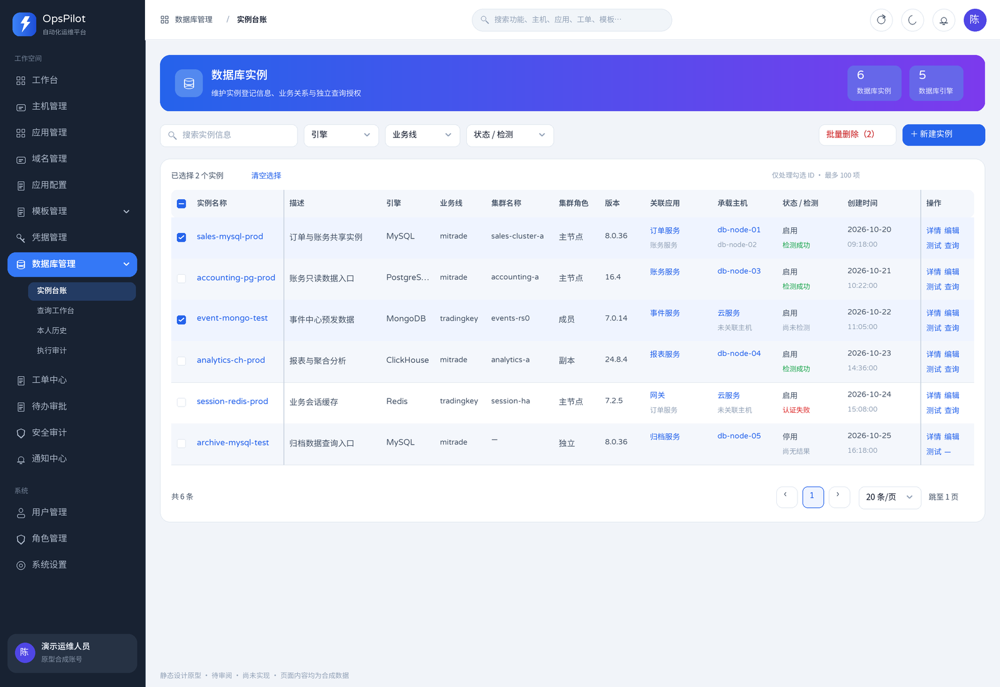
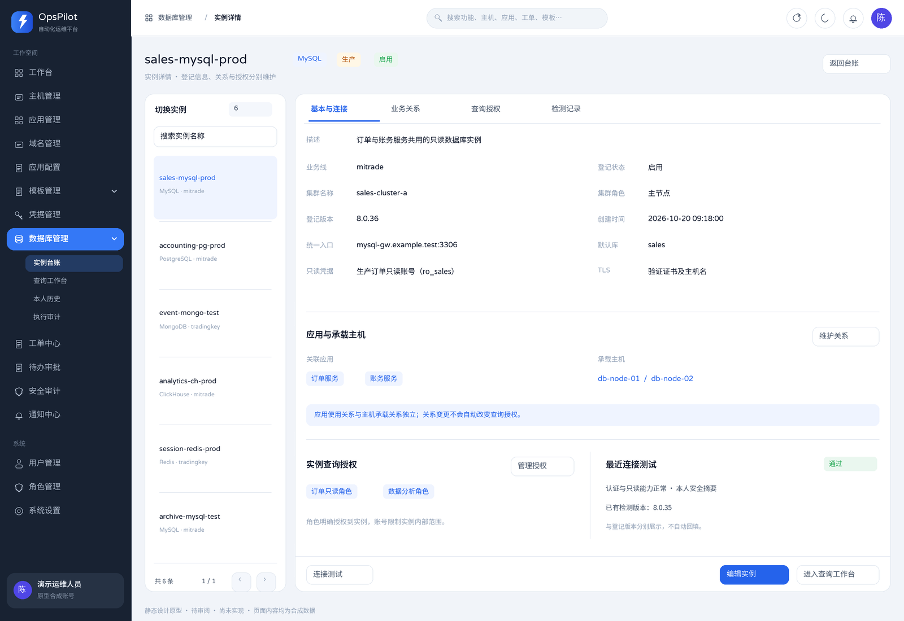
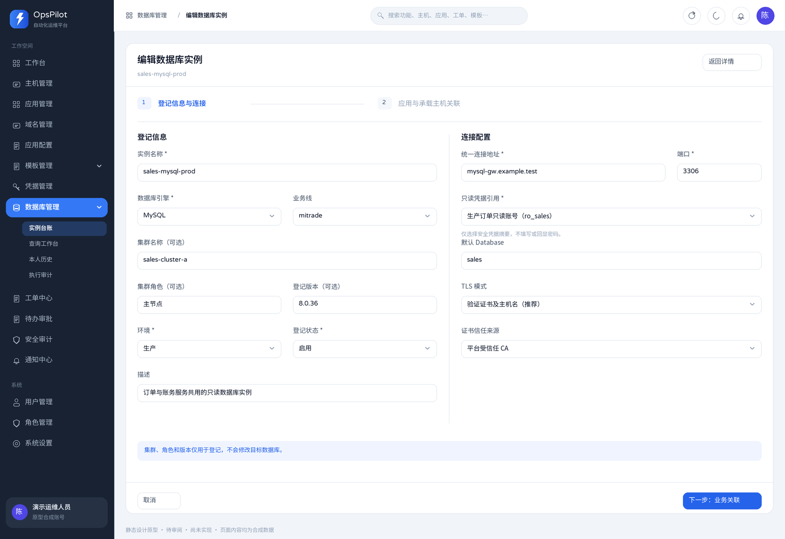
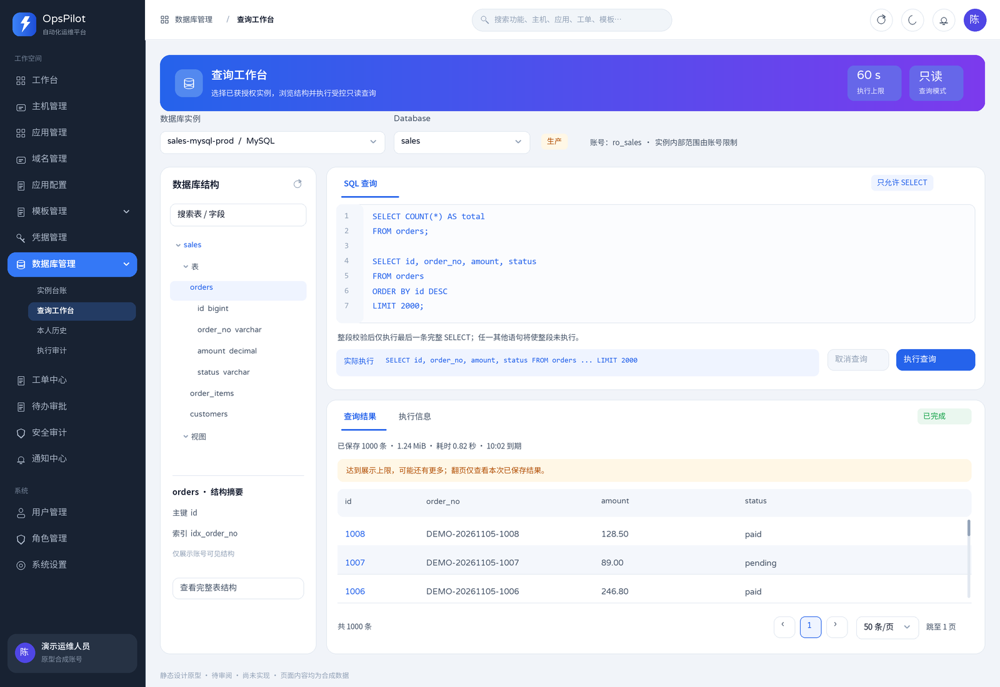
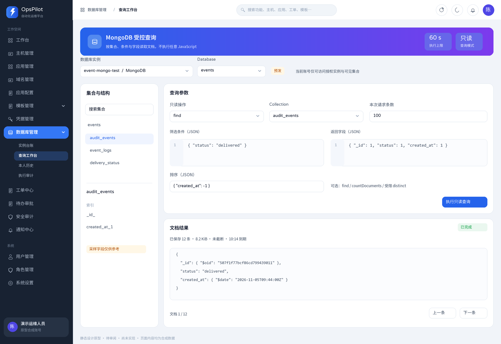
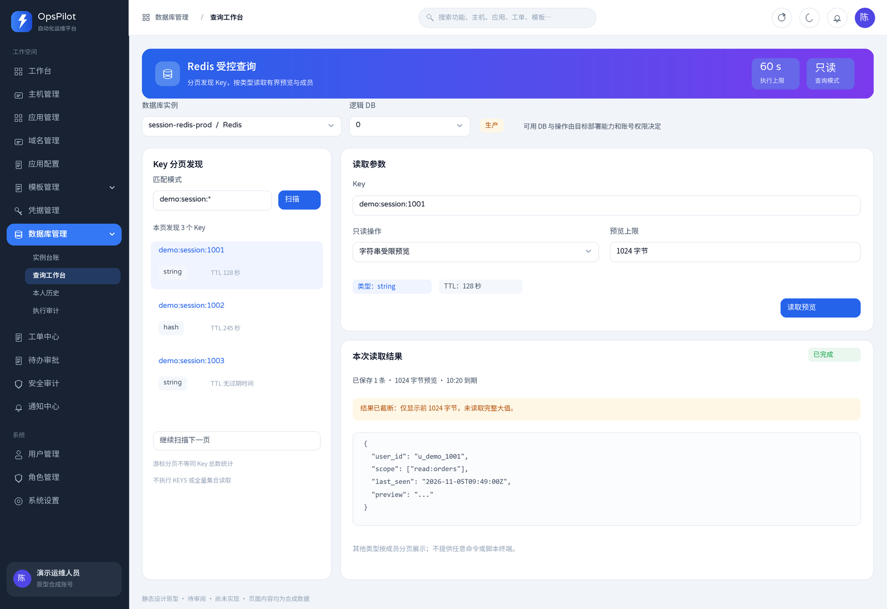
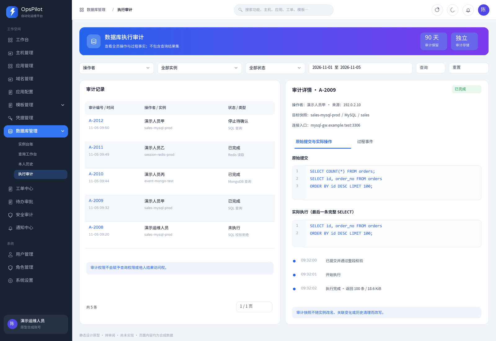
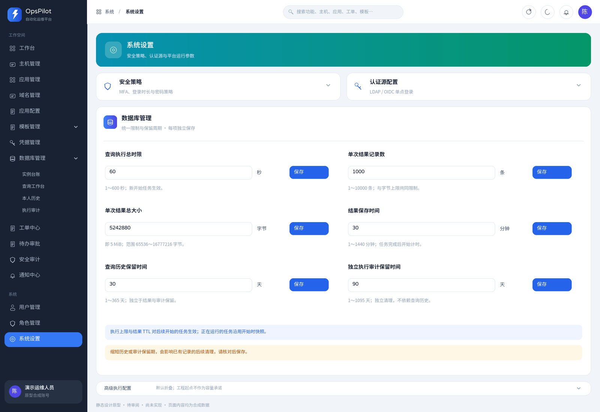
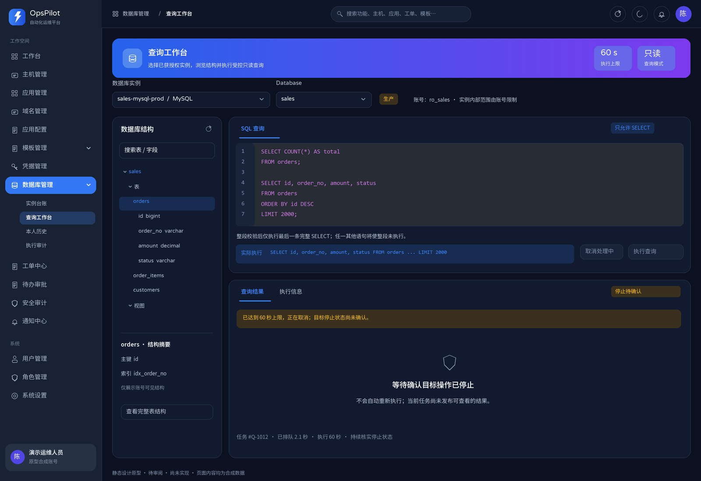

# 数据库管理 UI 设计原型

| 项目 | 内容 |
| --- | --- |
| 状态 | **历史静态设计参考；当前交互以下文及源码为准，运行验收另记** |
| 日期 | 2026-11-05 |
| 交付物 | 10 张历史静态页面图，每张提供 PNG 和 SVG；保留图稿，详情右侧抽屉与居中新建/编辑弹窗以当前文字说明为准 |
| 审阅范围 | 数据库实例台账、业务关联、实例授权、受控只读工作台、执行历史（仅本人）、独立审计和系统设置 |
| 图中数据 | 均为合成数据；连接地址使用 `example.test`，来源 IP 使用文档示例地址 |

本文保留已讨论的界面与交互基准，10张PNG/SVG为静态设计图，不替代当前Vue页面或运行截图；代码及认证后的实际验收分别见主源文档。保持原有平台品牌、字体、导航和审批界面风格，本次文档同步不重绘图稿。台账以应用管理同款边框表格、统一时间字号及下述关联表格规则为准；详情采用右侧抽屉，编辑采用居中弹窗，静态图中的独立详情/编辑页面及列表卡片不作为当前实现要求。

历史图稿不用于判断当前固定列、排序与拖宽、状态/TLS标签、关联表格列或保存流程；这些行为以本文当前文字为准。图中的旧关系说明、表单步骤和保存入口不作为本轮验收依据。

需求与当前合同分别见[PRD §8](./01-产品需求文档PRD.md#8-数据库管理)、[架构 §14](./02-技术架构设计.md#14-数据库管理)、[数据 §11](./03-数据库设计.md#11-数据库管理)、[API §14](./04-API设计.md#14-数据库管理)及[开发验收 §5](./05-开发与验收指南.md#5-数据库管理开发与验收)。本文只补充UI表达，静态图与已实现DTO有差异时以API/代码为准。

## 1. 视觉与布局基准

图稿制作时根据 [BasicLayout.vue](../frontend/src/layouts/BasicLayout.vue)、[tokens.css](../frontend/src/styles/tokens.css)、[App.vue](../frontend/src/App.vue)、[主题状态](../frontend/src/stores/theme.ts)、[应用管理](../frontend/src/views/cmdb/AppList.vue)、[系统设置](../frontend/src/views/system/SettingsPage.vue)和仓库已有浅色截图核对。该过程只审阅源码与静态图稿；当前页面的浏览器验收按[开发与验收指南](./05-开发与验收指南.md#56-本次验证范围与限制)单独记录。

| 元素 | 沿用方式 |
| --- | --- |
| 主视图 | 以当前实际默认的浅色主题为主，另提供同一工作台的暗色状态图 |
| 侧栏 | 宽 232px，浅色主题下仍使用 `#182232` 深色背景；激活项 `#3478f6`，保留 OpsPilot 闪电标记与既有菜单密度 |
| 顶栏 | 高 64px，左侧面包屑、中间统一搜索、右侧刷新/主题/通知/头像；不新增专属全局工具栏 |
| 浅色内容 | 页面底色 `#f1f4f9`，白卡，主色 `#2563eb`，正文 `#0f172a`，次级文本 `#475569`，边框 `#e2e8f0` |
| 暗色内容 | 页面底色 `#0b1120`，卡片 `#111a2e`，主色 `#3b82f6`；代码区沿用现有 oneDark 方向 |
| 组件形态 | 16px 卡片圆角、10px 按钮/输入圆角；管理页沿用渐变页头，设置沿用青绿色页头与可折叠配置块 |
| 字体 | 英文与数字使用 Varela Round，中文使用 Noto Sans SC；SQL/JSON 使用 Consolas 等宽字体 |
| 密度 | 筛选条、列表、右侧详情与两列字段布局沿用现有管理页；长结果在表体滚动，不把页面撑成无界长表 |
| 状态 | 绿色表示已确认完成，橙色表示排队/取消或停止未确认，红色表示拒绝/失败；同时保留明确文字，不仅靠颜色区分 |

所有主图为 1600×1100。PNG 是直接审阅图；SVG 保留可编辑的矢量结构，并内嵌所需字体分片/字形子集，不依赖临时生成目录。示意图中的当前时间、记录数和查询值不是运行监控数据。

## 2. 入口与权限

“数据库管理”作为既有侧栏的一组入口，位于“域名管理”之后、“应用配置”之前，展开“实例台账 / SQL工作台 / 执行历史 / 执行审计”。执行历史的侧栏和面包屑保留“执行历史”，页面标题为“数据库执行历史”，字号沿用实例台账的页头样式；路由及本人可见范围保持。系统配置继续放在既有“系统设置”。无可见子入口时隐藏整个数据库菜单组；不通过新增门户页改变日常导航。“SQL工作台”保留原有五引擎查询能力，MongoDB/Redis 继续使用受控原生表单。

| 入口或操作 | UI 行为与权限边界 |
| --- | --- |
| 实例台账 | 按管理权限显示维护入口，管理列表使用 `scope=management`；维护能力不等于查询能力 |
| SQL工作台 | 具备 `database:query` 才显示；实例选择固定请求 `scope=query`，即使兼具管理权限，也只显示当前显式获授权的实例 |
| 执行历史（仅本人） | 只显示本人；查询用户从该页查看数据操作。仅维护权限的用户也能通过行内测试反馈及该页查看本人probe进度与安全摘要，不必进入工作台 |
| 执行审计 | 需要 `database:audit`；可查看全员操作事实，不展示结果集，不提供他人结果入口 |
| 新建、连接测试 | 按 `database:write` 控制；probe 不额外要求查询权限或实例查询授权，不依赖查询策略接口 |
| 编辑实例 | 已有实例凭 `database:write` 或 `database:grant` 任一进入；只有授权权限时，实例字段和业务关系只读，仅能保存角色授权 |
| 管理授权 | 编辑弹窗第二步内需要 `database:grant`；通过统一“保存”提交实际角色改动，角色仍使用独立 API；无此权限不读取已授权角色或角色候选 |
| 结果读取 | 本人、当前实例查询权限、结果已完成且未过期；probe 例外仅允许本人凭维护权限查看安全摘要 |
| 系统设置 | 需要 `system:config`；普通查询用户只读取可公开的查询策略，不能读取完整系统配置 |

图稿展示相应能力均具备时的布局。实际使用时不展示无权限的操作按钮；既有关系可按合同只读回显。前端隐藏按钮不能代替服务端权限校验。

## 3. 实例台账



[查看 SVG 图稿](./images/database-ui-prototype/01-instance-list-light.svg)

**目的与布局：** 沿用渐变页头、AppList 工具栏和同款 `bordered` 表格，统一表头、单元格字号、分隔线与操作按钮风格，不再另包带大内边距的列表卡片。业务列严格为下表 12 项，另保留必要选择框与操作列；环境、TLS和凭据不在台账列表展示。长字段省略并可悬浮查看，创建时间沿用应用管理的完整本地日期时间，日期与时分秒使用相同字号。有删除权限时选择框列固定左侧；实例名称不固定，随其他业务列横向滚动，操作列固定右侧。12个业务列均支持拖动表头边界调整宽度和服务端排序，不靠缩小字体硬塞。

| 业务列 | 展示规则 |
| --- | --- |
| 实例名称 | 名称可打开详情，长名称悬浮显示完整值 |
| 描述 | 展示登记描述的受限摘要 |
| 引擎 | MySQL、PostgreSQL、MongoDB、ClickHouse、Redis |
| 业务线 | 显示登记值，未填写显示“—” |
| 集群名称 | 可空的手填登记元信息，不代表自动发现的拓扑 |
| 集群角色 | 可空的手填登记元信息，不把该值用于路由或主备切换 |
| 版本 | 显示人工登记版本，未填写显示“—”，不从连接检测自动发现或回填 |
| 连接地址 | 紧邻版本右侧，显示 `host:port`；IPv6 显示 `[host]:port`，长值省略且悬浮显示完整地址 |
| 关联应用 | 当前允许展示的应用名称，多项换行/省略并可查看完整列表 |
| 承载主机 | 当前允许展示的主机名称；云实例可无关联 |
| 状态 / 检测 | 使用两个独立彩色标签，中间以可见“/”分隔：登记状态为“启用”或“停用”，分别用success/default；检测为“成功”“失败”或“未检测”，分别用success/error/default。检测摘要仅保留在检测标签的悬浮title，不另显示摘要行 |
| 创建时间 | 与应用管理一致显示完整本地日期时间，日期与时分秒字号一致，不进入关键词匹配 |

**搜索：** 复用 AppList 的 220px 搜索框、搜索图标、清空控件和操作方式，文案为“搜索实例信息”。普通输入或清空后按回车提交，回车将页码恢复为 1；下拉条件变更立即筛选，不另设查询/重置按钮。由关联链接定位单个实例时，按精确 ID 筛选并在搜索框回显实例名称；刷新与同页切换目标后仍正确回显，主动改词或清空先解除旧 ID 约束，迟到响应不能覆盖新搜索。关键词匹配上述全部非时间业务列，包括地址、十进制端口、完整组合地址、单个状态词、检测安全摘要及可见应用/主机名称，并兼容原状态/检测组合词（如“启用/成功”）；IPv6 组合采用 `[host]:port`。不匹配TLS、凭据、其余隐藏连接参数或创建时间。

**筛选：** 依次为引擎、业务线、登记状态、集群名称，不再提供检测状态下拉；检测摘要仅保留在检测标签的悬浮title，仍可通过关键词搜索。集群名称使用可搜索、可清空下拉，候选来自当前授权范围的全部非空集群名称，不受当前页或其他筛选影响；选择后按完整名称等值筛选并回到第一页。

**排序与列宽：** 12个业务列均可按升序或降序请求完整筛选结果，服务端在筛选后、分页前排序；取消列排序恢复默认 ID 倒序，同值按 ID 倒序，空值和空关联始终置后。连接地址按 host、数值 port 比较，关联应用/主机按各自最小名称，状态按登记状态、检测状态比较。拖动列宽仅调整显示，范围为80～480px，仅保留在当前页面内存中，不持久化，也不触发排序或变更筛选；排序参数与完整比较规则见[API §14.2](./04-API设计.md#142-路由与关联)。

**按钮与跳转：** 名称/详情在当前台账右侧打开详情抽屉；编辑、新建打开居中弹窗，关闭后保留列表筛选和页码。“查询”进入 SQL工作台，并重新校验查询范围。每行保留“详情 / 编辑 / 测试 / 查询”，按各操作权限分别展示；编辑对 `database:write` 或 `database:grant` 任一开放，新建和测试仍需 `database:write`。右上角按权限提供“导入 / 导出 / 批量删除（数量） / 新建实例”，沿用主机管理列表的按钮和导入弹窗风格；导入需要 `database:import` 加 `database:write`，导出需要 `database:read`。原 `/database/instances/new`、`/database/instances/:id`、`/database/instances/:id/edit` 直达 URL 继续可用，由 InstanceList 承载相应弹层；旧编辑路由同样接受维护或授权权限任一，新建和详情路由权限不变。

**台账 Excel：** 导入弹窗提供模板下载、上传、按名称更新选项和逐行结果，显示成功、创建、更新数量及失败行原因。模板和导出仅包含实例名称、引擎、连接地址、端口、环境、描述、业务线、集群名称、集群角色、版本。新名称导入后显示为停用、未检测的待配置实例，用户进入编辑弹窗补齐凭据再启用；现有名称更新要求引擎不变，不改变凭据、查询角色、应用/主机关联、连接选项、最近检测或启停状态。导出沿用当前列表筛选，不导出凭据或工作台查询结果。

**行内测试：** 按 `database:write` 展示，参考域名管理列表同步按钮，点击后对应行“测试”从提交起持续loading，覆盖排队、执行和停止待确认，不再打开“本人连接测试”Modal。各实例独立跟踪，同行禁止重复提交，其他行仍可测试；列表刷新、重排不会丢失原任务。底层仍异步提交单项probe并跟踪终态，仅连接/认证和平台固定SELECT 1或ping，不设置或校验只读，不执行用户操作。HTTP 202、排队或执行中不代表通过，不提前提示成功；仅`succeeded`使用Ant message.success提示实例名与“数据库连接测试通过”，其他终态或明确拒绝使用message.error，结果未知使用message.warning，随后刷新列表。失败或未知反馈只含安全原因，并以文字提示到本人历史核对，已知任务附任务编号，不自动跳转。临时读取失败时保留本行loading，仅重试状态GET；提交结果未知或任务身份/读取权限等导致状态无法确认时，停止本页跟踪并禁用当前页面的同行测试，先核对本人历史，再刷新页面主动测试，不自动重复提交probe。容量不足直接提示拒绝，不自动重投。离页中止客户端请求和计时器，不弹迟到提示、不刷新已离开的列表，也不代表服务端任务已取消。无查询权限的维护者仍可核对本人probe进度与安全摘要，不能由此读取业务结果；数据和元数据查询继续使用原有只读措施。

**批量选择与权限：** 只处理本次显式勾选并去重的实例 ID，一次最多 100 项，不支持“全部筛选结果”。沿用现有列表刷新后清空选择的方式；搜索、翻页或筛选刷新后重新勾选，不把旧选择悄悄带入新列表。无选择时批量删除禁用；删除按钮按独立的 `database:delete` 显隐，不能由维护权限代替。提交中禁用重复点击，反馈区逐项保留实例、删除状态和安全原因。

| 删除场景 | 交互与逐项结果 |
| --- | --- |
| 批量删除 | 确认显式勾选数量后，串行复用单项删除接口。逐项展示“已删除 / 拒绝 / 请求结果未知”；只有停用且无排队、执行、停止或恢复中任务的实例可删。角色授权关系不单独阻塞删除；成功项同步清理应用/主机/角色关联，失败项不回滚成功项 |
| 网络结果未知 | 明确标为未知，不自动重试或伪称失败；先核对已有记录，再由用户处理剩余项，避免重复提交 |

失败/拒绝项可以由用户明确重新选择处理，不自动重放。部分失败不能只弹一句“批量成功”，最终必须保留逐项反馈。

**权限与关系：** 同一实例可被多个应用使用，云数据库可以没有 CMDB 主机。点击应用/主机按精确 ID 跳转并保留目标详情交互，不使用名称模糊搜索；修改检索词后清除先前的关联 ID 条件。

**空态与异常：** 无实例时显示“暂无数据库实例”，有维护权限才提供新建按钮；筛选无命中显示“未找到匹配实例 / 清除筛选”。Excel 新建的待配置实例保留在台账，未绑定凭据时不能启用或测试。检测失败以标签和悬浮安全摘要说明，区分认证、不可达与不兼容；停用和检测失败不能混成同一状态。详情与本人历史仍可查看安全摘要。查询用户没有获授权实例时显示“暂无可查询实例，请联系授权管理员”。

## 4. 实例详情、业务关系与授权



[查看 SVG 图稿](./images/database-ui-prototype/02-instance-detail-light.svg)

**目的与布局：** 沿用应用管理详情交互，点击实例名称或“详情”在台账右侧弹出宽650px的单一抽屉，背景保留当前列表，不再跳转独立详情页，也不保留独立页的左侧实例切换列表。基本/连接使用AppList同款单列 `bordered`、`small` 描述表，具备 `database:grant` 时在表内展示授权角色摘要；关联应用、承载主机分别用标题与带边框三列表格呈现，最近检测继续在同一外框展示，不拆独立卡片。内容超出时在抽屉内部滚动。详情不提供“维护关系 / 管理授权”按钮、授权解释提示、蓝色关系提示或底部操作按钮。详情按 ID 独立读取，不要求目标已在当前分页中。只有查询权限的用户直达旧详情地址时，背景列表使用 `scope=query`；关闭返回 SQL工作台，不扩大管理列表权限。管理用户关闭直达详情回台账。切换实例只切换详情对象，不自动查询或检测。

抽屉先展示无独立标题的单列描述表，再依次展示“关联应用 / 承载主机 / 最近连接测试”标题及对应内容，不再设置独立的查询授权分区，通过抽屉内部滚动查看。布局、固定列和自适应高度等设计说明只保留在本文，不放入产品页面文案。

集群名称、集群角色和登记版本均为可空普通台账信息，不新增拓扑图或自动发现能力。已有历史检测摘要含版本时不自动回填登记版本；新probe只做连接与认证，不采集或验证业务只读能力。连接地址在台账和详情均可见，TLS、默认上下文与凭据安全摘要仍在详情查看。TLS开启/关闭分别使用success/default标签，开启时继续展示证书及主机名是否验证，颜色不替代状态文字。

**关系展示：** 关联应用按“应用名 / 语言 / 部署方式”，承载主机按“主机名 / IP 地址 / 环境”展示。语言、部署方式和主机环境仅具备 `cmdb:read` 时返回并展示，无权限时不读取对应 CMDB 详情，新增单元格显示“—”；名称和已有安全摘要仍可回显，链接继续检查目标读取权限。两条关系保持独立，不把应用原部署主机自动带入此处；云服务无主机时显示“未关联 CMDB 主机”，页面不再显示蓝色关系提示。修改关系从列表“编辑”进入弹窗第二步，不编辑应用或主机本体。

**授权展示：** 授权角色摘要移入顶部单列详情表的“查询角色”一行；无 `database:grant` 不读取或展示角色授权，该单元格显示“—”。详情内不提供授权编辑入口，角色维护统一放在已有实例编辑弹窗第二步。应用关联变化不会增加或删除角色查询授权；页面不出现库级或应用继承授权开关。

**检测展示：** 详情只展示最近检测时间、状态与安全摘要，发起入口保留在列表行内“测试”。行内操作通过loading及最终Ant message反馈，详情和本人历史用于核对安全摘要，不再弹出本人连接测试Modal，也不直接渲染原始JSON。新任务摘要为“连接状态检测”，台账最近检测成功摘要为“连接检测成功”，适配器probe摘要消息为“连接和认证成功”；行内成功消息使用上述“数据库连接测试通过”，不清洗已有历史摘要。凭据只显示引用名称与账号摘要，失败信息不回显密码、密文或敏感连接参数。

**空态与异常：** 无应用/主机关联时分别显示独立空态；已成功读取且无授权角色时显示“尚未授权查询角色”，读取失败不能显示成未授权。引用被删除、实例已变化或权限撤销时刷新摘要并停止相应操作。

## 5. 新建 / 编辑实例表单



[查看 SVG 图稿](./images/database-ui-prototype/03-instance-form-light.svg)

**目的与布局：** 沿用应用管理编辑按钮交互，新建与编辑共用居中 Modal，不跳转独立编辑页。弹窗宽度适配视口，内容过高时内部滚动；第一步为“登记信息与连接”，第二步为“业务关联与授权”，集中展示业务关系与实例查询授权。第一步采用行对齐的双列字段布局，TLS紧邻登记状态，描述横跨两栏占整行，不再以登记/连接两个独立区块形成高低不齐的列。删除原集群登记说明、可维护时的关系说明和安全凭据摘要提示；关系无权限时的只读功能和提示保持。保留原字体字号、控件高度及字段间距。第二步底部只提供一个“保存”，按当前权限与实际改动提交实例和角色；全部所需请求成功后关闭并刷新列表，部分成功保留弹窗及明确反馈。关闭不提交尚未保存的内容，也不回滚已经成功的请求；重新打开从当前实例读取。原 `?step=2` 入口仍可直接打开第二步。

第一步维护名称、描述、引擎、业务线、可选集群名称/集群角色/登记版本、环境与启停状态，以及统一地址/端口、兼容只读凭据、必要上下文和 TLS。业务线沿用现有候选且可不填；集群名称/角色/版本分别允许为空，登记长度上限为 128/64/128 字符，不作为连接路由或拓扑管理配置。它们的编辑不改变连接配置修订，不触发版本发现或自动同步。Excel 导入的待配置实例允许暂时无凭据，补齐兼容凭据前启用开关不可提交；补齐后可在本弹窗启用。页面不设置密码输入框，也不支持将密码写进地址。本轮字段精简只涉及数据库实例，应用既有信息保持现状。

| 引擎 | 连接字段的界面差异 |
| --- | --- |
| MySQL | 默认 Database 可选并占整行；显示适用的连接/TLS 参数 |
| PostgreSQL | 连接 Database 必填，与默认 Schema 成对排列；查询时仍按库内上下文选择 Schema |
| ClickHouse | 默认 Database 占整行，端口与 TLS 沿用通用字段，不暗示所有协议均已兼容 |
| MongoDB | 默认业务 Database 与认证 Database 成对排列；无任意连接参数透传框 |
| Redis | 逻辑 DB 与认证方式成对排列，区分仅口令与 ACL 账号认证；逻辑 DB 受目标能力限制，账号标签不能被误当必填认证用户名 |

第二步沿用现有关联多选方式：应用多选、承载主机多选、已选摘要。返回第一步保留已填内容。只有 `database:write` 且具备关系所需的读取权限时可维护关系，否则只读回显，实例保存省略无权修改的关系字段。已有实例编辑凭 `database:write` 或 `database:grant` 任一进入；只有 `database:grant` 时直接进入第二步，第一步字段及第二步关系均只读，统一保存仅提交角色变化，也不请求凭据或关系候选。新建仍只允许 `database:write`。

第二步在关系区域之外提供角色多选，需要 `database:grant`，不要求 `database:write`，不再设置单独“保存授权”按钮。无授权权限不读取已授权角色或角色候选；具备授权权限时，已有实例需当前授权与候选均读取成功，新建需候选读取成功后才启用统一保存，失败时保留明确错误及已取得的角色名称并允许重试，不能把失败当作空角色列表。统一保存按当前权限和规范化后的实际改动调用现有接口：仅实例变化只写实例，仅角色变化只写角色，两者变化先实例后角色，均无变化不发写请求。角色有变化时提交前重新读取当前角色集合；已等于本次选择时按已生效处理，不再写入，其他与加载基线不同的集合停止覆盖，重新加载后再确认。两个请求不组成原子事务；实例成功而授权失败时明确提示部分成功，保留弹窗和实例ID，锁定已保存实例字段，重试只处理授权，不重写已保存实例。新建可在同一弹窗选择角色，保存时先创建实例再维护授权，授权失败也保留新ID供重试。

**校验与异常：** 必填缺失、端口越界、地址含敏感参数和不兼容凭据在对应字段展示错误；失败不清空表单。保存成功表示本次所需的台账/授权请求已完成，不提示数据库已创建或连接测试已通过。引擎切换时提示将清理不适用的专属字段；未保存关闭不提交表单，重新打开时回读当前记录。

**创建结果未知：** 创建 POST 已发出但未收到 HTTP 响应时（如网络中断或请求超时），禁用当前弹窗的保存、实例字段和角色选择，取消/关闭仍可用。页面刷新台账，并提示关闭后按完整实例名称人工核对；若找到已创建记录，进入其编辑弹窗继续维护授权。明确返回的 HTTP 或业务错误仍允许修正后重试；无响应时不自动重发 POST、不自动恢复创建 ID，不把未知结果提示为确定失败，也不提供后端幂等保证。

## 6. SQL工作台：结构、输入与结果



[查看 SVG 图稿](./images/database-ui-prototype/04-sql-workbench-light.svg)

**目的与布局：** 当前页面沿用实例台账同款蓝色渐变页头与数据库图标，标题为“SQL工作台”，不新增副标题；页头右侧回显最近一次连接测试状态，悬浮查看时间，不把选择实例或读取台账等同于实时连接可用。下方保留一个完整工作区，连接栏集中选择实例、Database，以及PostgreSQL的Schema或Redis的逻辑DB，右侧显示账号摘要、只读模式和当前执行上限。连接栏下方左侧为对象浏览器，右侧上方为编辑器或受控原生表单，下方为“查询结果 / 表结构 / 执行信息”三个页签，不将编辑器、结果分别包成卡片。桌面页容器固定为视口减112px的高度，工作区及主体填满剩余空间；对象浏览器、编辑区和输出页签各自内部滚动，内容增加不撑高外框。800px及以下恢复内容高度。

SQL编辑框可从底部纵向拖动，初始高度260px、最小120px；桌面最大高度随视口收紧且不超过520px，编辑区为输出区预留至少150px，超出内容在区内滚动。800px及以下编辑框上限为520px，页面随内容自然增长。高度调整不持久化，编辑器重新挂载后恢复默认并受当前可用高度约束。

上图继续作为历史设计参考，图中的旧布局、三行样例、每页50条及共1000条均不是当前运行结果或固定容量承诺；本轮已确认的工作台重设计以当前文字和Vue源码为准。

**对象浏览与刷新：** 非Redis引擎仅按已返回的元数据组织Database、可选Schema、表或集合及当前已读取字段，默认值和手工输入的上下文不自动成为可见树节点。搜索仅筛选已加载对象名及当前对象已读取的字段，不发起数据库查询，不推断未读取字段、索引或约束。已加载数量仅统计本次保存结果；对象列表达到上限时提示可能还有更多，不表示全库完整数量。选择对象只读取受控字段元数据并清除旧查询状态，不自动执行业务SQL；“生成 SELECT”是独立按钮，只填充编辑器，PostgreSQL使用当前Schema并按引擎转义标识符。刷新可见库、刷新当前上下文或当前对象结构均沿用受控元数据任务，不建立跨实例、库、Schema或对象复用的结构缓存。主动刷新可见库时，对象浏览器右上角刷新按钮仅在该命令的databases阶段显示loading，后续自动读取不延续此动画；点击表或集合读取字段时，同一刷新按钮显示单个spinner，编辑器“刷新结构”按钮不同时转动。元数据忙时禁止重复刷新，主动取消后由“取消结构读取”按钮接管loading。浏览器底部保留读取文字、已加载数量及异常入口，不叠加旋转加载图标。

| 输出页签 | 当前内容 |
| --- | --- |
| 查询结果 | 本次查询保存结果、截断和到期信息，使用现有结果表及分页；任务进行中、错误或过期均显示对应状态，不自动重跑 |
| 表结构 | 当前选中表的字段结果或MongoDB采样字段，按保存结果分页；结构标题仅显示对象名，不额外显示`inferred`采样说明，没有索引、约束或结构编辑入口。Redis明确提示不提供表结构 |
| 执行信息 | 分别展示查询任务和对象浏览元数据任务的状态、实际操作及错误；Redis只展示查询任务。不展示停止确认标签和原始停止依据块，stopping/recovering警告仍保留；本人历史同样不展示停止依据，独立审计继续保留原有事实与依据 |

桌面页签栏同时显示查询状态及任务编号，元数据读取文字保留在对象浏览器底部，读取异常可进入“执行信息”核对。执行查询回到“查询结果”；切换页签只切换展示，不新建查询或重读目标库。

**页面文案与执行策略：** 工具栏不再显示“仅允许SELECT”，编辑器脚注仅保留行数与UTF-8字节计数，不重复显示最后一条SELECT规则；对象数量后不附账号范围说明，结果页脚不附导出说明，结构标题不附采样说明。服务端整段校验、最后一条允许SELECT选择、绑定账号权限、独立审计、结果行数/字节/有效期限制和无导出能力继续生效；采样字段仍保持其元数据含义，不因隐藏说明变成真实约束。

**查询规则：** 适用于 MySQL、PostgreSQL、ClickHouse。执行时提交编辑器整段原文，允许一条 SELECT 跨行，也允许多条语句以分号分隔。服务端完整校验全部输入，仅选择最后一条完整且允许的 SELECT；只要混入 UPDATE/DELETE/SET 等其他语句、解析失败或只读校验不通过，整段显示“未执行”，不执行其中任何 SELECT。前端不自行按分号截取、不只发送选中文字。

“实际执行”显示服务端返回的选择结果，不将其当作用户二次确认步骤；较长摘要可展开查看完整文本。图中前一条 COUNT 不执行，最后一条 SELECT 即使写了 LIMIT 2000，也仍受平台 1000 条/5 MiB 上限约束。执行时限初值 60 秒，页面显示当前策略，任务开始后显示该次快照，不允许普通用户临时调高。

| 控件 | 行为 |
| --- | --- |
| 实例 / 上下文选择 | 实例仅来自 `scope=query`；改变实例、Database或Schema立即清除旧对象、结构及查询结果，选择候选或回车后读取当前上下文，旧请求不能回写新页面 |
| 刷新结构 / 取消结构读取 | 根据当前对象、上下文或库选择发起受控元数据任务；读取中可申请取消，进度与错误在对象浏览及执行信息查看，不提供结构编辑 |
| 生成 SELECT | 仅SQL三引擎在已选表时提供，填充整表SELECT文本，不自动执行，也不改变服务端整段校验规则 |
| 执行查询 | 短请求提交；返回受理后显示排队；提交未完成时阻止重复点击，不把 202 当查询完成 |
| 取消查询 | 对本人任务登记取消；显示“取消处理中”，只有服务端确认停止后才显示已取消/已超时 |
| 结果分页 | 仅读取同一次已保存结果，不再次执行 SQL；同任务翻页在途保留当前页并显示表格loading遮罩，成功后替换。读取失败、撤权、到期或切换任务/上下文立即清空；总数是保存行数，不是目标表总行数 |
| 单元格预览 | 纯文本、受限展开；重名列按原序保留，悬浮说明列序号，不按列名合并；大整数、Decimal、日期、二进制保留明确类型表示 |

**命令按钮加载：** 执行查询/只读操作、刷新结构、取消结构/查询、Redis扫描/继续扫描/成员下一页按发起命令分别显示loading，每个按钮仅有一个旋转图标，替换原图标，不叠加显示。查询提交及排队、执行、停止待确认期间，仅本次发起按钮转动；主动取消后由对应取消按钮接管，任务未终结时继续跟踪，不把取消响应当作已停止。结构刷新覆盖其本次读取链路，包括PostgreSQL的Schema到表列表；点击对象读取字段使用对象浏览器刷新按钮反馈，初始化、切换库/Schema和其他自动后台读取不点亮无关命令按钮。生成SELECT和对象展开/收起立即完成，不显示loading；同任务结果翻页通过表格loading遮罩反馈，保留底层当前页直至成功替换或发生清屏条件。

翻页等待期间，原结果到期计时继续生效。分页读取失败时清除旧页并保留错误；结果到期时清屏、结束loading并使在途分页失效，迟到响应不能恢复旧数据。切换任务、实例、库、Schema或对象以及重新提交查询时立即清除旧页，不沿用翻页等待时的保留行为。

**结果上限：** 初值为 1000 条、5242880 字节（5 MiB），先到任一上限即停止继续收集并提示截断。摘要显示保存行数、大小、耗时、截断原因及到期时间；仅达到上限但无法证明还有数据时用“可能还有更多”。结果完成后默认保留 30 分钟，不提供导出或全量加载按钮。

**空态与异常：** 加载实例时显示骨架，无实例时显示选择引导或“暂无可查询实例，请联系授权管理员”；无查询功能权限时显示明确提示，不加载实例或策略。零行保存结果保留列结构。尚未ready的结果显示处理中；过期显示“结果已过期”；403或撤权先清除结果与内存缓存，再显示无权限信息。结构未选择、读取中、失败和过期分别使用对应提示，不能保留旧对象字段。连接失败和方言拒绝展示安全原因；输入超出65536 UTF-8字节时提示整段拒绝且超长正文不留存。查询结果不存入浏览器持久存储，HTML/脚本文本只作为文字展示。

## 7. MongoDB 受控原生入口



[查看 SVG 图稿](./images/database-ui-prototype/05-mongodb-workbench-light.svg)

**目的与布局：** 共用上述紧凑连接栏、对象浏览器和三个输出页签，将SQL编辑器替换为明确的操作表单。左侧为Database/Collection与已读取采样字段；右侧包含操作类型、集合、筛选JSON、返回字段JSON、排序和请求条数，下方“查询结果”查看保存文档，“表结构”查看采样字段，“执行信息”核对查询及元数据任务。

首批操作为 find、countDocuments 和受限 distinct；UI 名称映射到已定义 DTO，不开放任意 JavaScript、aggregate、runCommand 或方法名称输入。切换操作时仅保留适用参数，distinct 的字段和有界读取能力按目标支持情况呈现；不支持时显示原因，不退回无界读取。

**执行与结果：** 执行前验证 JSON 语法，服务端仍验证结构和白名单。示例按类型显示 ObjectId/日期，并通过文档上一条/下一条读取同一保存结果。采样推断字段明确标为推断，不能冒充真实约束。继续沿用本人权限、60 秒初值、1000 条/5 MiB、30 分钟 TTL、取消和无导出的统一行为。

**空态与异常：** 无可见集合显示账号可见范围空态；非法 JSON 在字段附近报错；无权限、集合不存在、目标能力不支持及超大单文档按安全错误展示。任何错误不自动改用脚本或无限制查询。

## 8. Redis 受控原生入口



[查看 SVG 图稿](./images/database-ui-prototype/06-redis-workbench-light.svg)

**目的与布局：** 上方实例/逻辑 DB，左侧按模式分页发现 Key，显示类型及 TTL；右侧按选中 Key 的类型提供受控读取表单与预览。图中的内容是预览片段，不把 JSON 外观误认为 Redis 的真实数据类型；所选 Key 实际类型为 string。

“扫描 / 继续扫描下一页”使用游标分页，不把本页数量当 Key 总数。类型、TTL、长度、字符串受限预览及 Hash/List/Set/SortedSet 成员分页通过明确控件选择；不出现任意命令终端、脚本入口、KEYS 或全量集合读取按钮。字符串预览明确显示上限与截断，不能先完整读取再截断界面。

逻辑 DB 只显示目标部署支持的可选范围；不将 DB 编号宣称为角色隔离边界。执行、分页、取消、结果权限及保存期与 SQL 工作台一致，所有读取均受全局预算约束。

**空态与异常：** 扫描未命中显示“本页未发现匹配 Key，可继续扫描”；游标结束显示“扫描完成”。Key 在选择后过期显示“Key 已不存在”，类型变化提示刷新；部署不支持逻辑 DB 或当前操作时明确说明，不自动改命令绕过。TTL 无到期时间与 Key 不存在分别显示。

## 9. 执行历史入口与本人记录

**目的与布局：** 蓝色页头标题为“数据库执行历史”，字号沿用实例台账；侧栏和面包屑保留“执行历史”，路由保持不变，仍仅查看本人操作。页头保留本人操作说明，移除额外的“仅本人可见”标签，具有查询权限时提供“打开查询工作台”。筛选区沿用工单中心的紧凑工具栏，控件按需换行；以“搜索执行历史”输入替换实例ID输入，结合引擎、操作类型、状态和提交时间范围组合查询，不设“查询”“重置”“刷新”按钮。引擎、操作类型或状态选定及清空后立即查询并回到第一页。搜索最多255字符，普通输入仅修改草稿，按Enter去除首尾空白后提交并回到第一页；点击搜索框清空图标立即移除已提交关键词、保留其他筛选并查询，手动删空仍等待Enter。下拉、时间和分页仅使用已提交关键词，不提前提交搜索草稿；服务端筛选、计数后分页，不只过滤当前页。

搜索覆盖列表可见的非时间戳内容：操作编号、实例名、引擎/上下文、操作摘要/类型、状态、格式化执行耗时及结果摘要；不搜索提交/到期等时间戳、SQL全文、隐藏连接或凭据快照、业务结果单元格。百分号、下划线等按字面字符匹配；结果过期或不可用时，不再匹配界面已隐藏的数量摘要。

提交时间沿用工单中心同款单个RangePicker，包含时间及“最近7天 / 最近30天 / 最近90天”快捷项，初次进入默认从当前本地时刻回溯30天。选定完整范围、选择快捷项或清空范围后立即查询并回到第一页，仅选择起点等未完成的日历操作不请求。前端将本地起止时间转为ISO参数started_from/started_to；历史结束参数在所选秒上增加1秒以覆盖该秒内提交的记录，控件显示不变，仍按首次提交created_at筛选。清空范围后不传两个时间参数，保留其他条件；90天快捷项不扩大已配置的历史保留范围。历史与审计分别保存筛选和分页，从审计切回历史时恢复默认30天并清空历史其他筛选；审计交互及参数保持。筛选和列表分页只更新列表，翻页保留已提交条件，不关闭已打开的详情抽屉，也不创建执行任务。

下方为工单中心同款带边框的全宽操作列表，沿用其表格密度与字号，不再外包独立列表卡片或“操作记录”标题栏。展示操作编号、实例/上下文、操作摘要与类型、提交时间、状态、执行耗时、结果摘要和查看详情入口。耗时按任务真实起止时间计算，活动任务显示当前已用时；条数、字节数、截断和到期时间只取任务返回的摘要，缺失值不以原型样例补齐。连接测试仅显示安全摘要，不提供结果集。点击记录或详情入口打开右侧详情抽屉，默认“概览”；桌面宽780px，窄屏占满可用宽度，抽屉内滚动并保留底部操作。1024px及以下，侧栏由顶栏导航按钮打开为覆盖菜单，主区占满可用宽度；菜单可通过遮罩、关闭按钮、Esc或导航关闭，宽表仅在表格内部横向滚动。

| 抽屉页签 | 当前内容与边界 |
| --- | --- |
| 概览 | 展示任务目标与上下文、耗时/结果条数/大小/提交时间摘要，以及真实开始、结束时间；原始提交按纯文本展示，实际执行存在且与提交不同时另列区块，结果摘要可进入结果页 |
| 结果 | 用户主动进入时按需读取保存结果，不因打开概览或过程而读取业务行；仅本人、当前有查询权限且成功的非probe任务可查看，已知到期时显示过期。分页复用现有结果表，只读取同次保存结果，不重跑SQL，不提供导出 |
| 过程 | 按任务真实created_at、started_at、finished_at生成提交、开始及终态节点，缺少的时间不补造节点；尚无结束时间时显示当前状态。本人任务接口不含逐条审计事件，不展示虚构的“查询校验通过”事件，也不将节点数固定为原型中的4条 |

抽屉标题保留当前任务状态，页签上方公共区域展示已有安全错误和停止处理中警告。本人详情移除简短停止确认状态、“查看停止依据”入口、原始停止依据JSON，以及stop_reason/error_code技术字段；保留真实状态、时间线和面向用户的error_message。stopping/recovering仍明确提示目标停止尚未确认，不显示为已取消。此调整仅影响本人详情展示，API字段及独立审计的停止事实与原始依据保持。原始提交混入UPDATE等不允许语句时，展示“未执行”及真实拒绝原因，不显示实际执行区块或已执行最后一条SELECT。可取消的本人活动任务保留“申请取消”，请求受理不当作停止完成。

底部“带入工作台编辑”仅对具有查询权限的SQL任务提供，复制原输入和目标上下文供本人编辑，不自动提交或重新执行；工作台仍校验当前实例授权。关闭抽屉会清除本页任务、结果、轮询和到期计时，迟到响应不能回写，也不代表服务端任务被取消；切换记录或路由同样隔离旧会话。结果读取时再次校验本人和当前实例授权，到期或撤权后清除已渲染结果，历史详情继续按其保留期管理。默认历史保留30天、结果保留30分钟，未终态的恢复任务仍持续可见；历史清理不让仍有效结果或未完成的恢复依据提前消失。

**空态与异常：** 无历史显示本人记录空态，筛选无命中可清空关键词或调整各项条件；详情读取、结果未就绪、失败与到期分别显示真实提示，不以重跑查询代替读取。仅维护权限的用户仍可核对本人连接测试进度与安全摘要，不能读取业务结果；仅审计权限不能借此页查看他人历史或结果。全员执行审计继续使用独立入口，不复用本人结果页。

## 10. 独立执行审计



[查看 SVG 图稿](./images/database-ui-prototype/08-execution-audit-light.svg)

**目的与布局：** 审计页沿用执行历史的蓝色页头、紧凑可换行筛选栏、全宽带边框表格和右侧详情抽屉，不再使用列表与详情并列卡片。关键词仅按现有接口搜索操作者或实例，输入后按 Enter 查询；引擎、操作类型、状态及单个提交时间范围选定或清空后立即查询，并回到第一页。时间范围默认最近 30 天，提供最近 7/30/90 天快捷项；清空后可查看审计保留期内全部记录。实例 ID、操作者 ID、来源 IP 和 Database 上下文保留在“更多筛选”，按原接口语义组合查询。审计默认独立保留 90 天。

列表展示操作编号、操作者与来源 IP、实例与上下文、操作摘要与类型、提交时间及状态；点击记录打开右侧抽屉，按概览、过程事件和安全快照组织原有审计事实。筛选及分页只更新列表，详情读取中的旧响应不得覆盖新记录；关闭抽屉或撤销审计权限时清除旧详情。

历史图稿中的双栏仅作早期参考。提交两条 SELECT 时仍只执行最后一条；时间线保留原始事件、校验与停止确认依据。审计只显示返回行数/大小等摘要，不显示业务结果单元格，也不提供结果下载、导出或跳往他人结果的按钮。实例、用户或历史已删除时仍展示独立审计快照。

**权限与异常：** 页面只需审计权限，不自动授予查询权限。审计无命中显示筛选空态；读取失败显示安全错误与重试。校验拒绝、排队过期、执行失败、超时确认停止及停止待确认分别展示，不以“失败”统一掩盖事实。通用安全审计仍保留CSV/XLSX导出，不受独立执行审计无导出入口的限制。

**通用安全审计局部对齐：** 既有安全审计页的筛选栏沿用本页紧凑布局。关键词按Enter提交、清空图标即查；模块、结果和单个带时间范围选定或清空即查，首次默认最近30天并提供7/30/90天快捷项。“更多筛选”保留操作人和动作，按Enter提交或清空即查；分页保留已提交条件，导出CSV/XLSX只使用已提交筛选，不采纳未提交的输入草稿。通用审计API的`start`直接使用RangePicker本地`YYYY-MM-DD HH:mm:ss`，不转UTC ISO；`end`为闭区间，在所选本地结束秒后追加`.999999`再提交，清空范围则不传起止参数；不修改接口筛选语义。

## 11. 系统设置：六项独立业务参数



[查看 SVG 图稿](./images/database-ui-prototype/09-system-settings-light.svg)

**目的与布局：** 在既有“系统设置”增加可折叠数据库配置块，保持原认证/安全块风格。图中上方其他设置为折叠示意，不表示合并或重构原 LDAP/OIDC 表单。六项独立输入，沿用响应式网格排列；卡片头部的“保存”按钮和折叠图标与同页其他设置卡片对齐，点击保存不触发卡片折叠。字段旁不再提供单项保存按钮，图中的旧保存入口不作为当前要求。高级执行配置保持折叠，不把工程初值展示为平台容量承诺。

| 字段 | 初值与单位 | 校验范围 | 生效说明 |
| --- | --- | --- | --- |
| 查询执行总时限 | 60 秒 | 整数 1～600 | 后续开始任务使用新值，运行任务沿用原截止时间 |
| 单次结果记录数 | 1000 条 | 整数 1～10000 | 与字节上限同时限制，任务开始时快照 |
| 单次结果总大小 | 5242880 字节，辅助显示 5 MiB | 整数 65536～16777216 | 输入始终为整数字节，不以 MiB 四舍五入改变保存值 |
| 结果保存时间 | 30 分钟 | 整数 1～1440 | 任务开始时快照，完成后计算到期时间 |
| 查询历史保留时间 | 30 天 | 整数 1～365 | 维护任务按当前配置独立清理 |
| 独立执行审计保留时间 | 90 天 | 整数 1～1095 | 审计按独立事件组与当前配置清理 |

**按钮与反馈：** 点击“保存”先校验全部六项，任一项非法则显示对应字段错误，整次不提交；拒绝空值、小数、布尔值及越界值，不用截断/取整把非法值变合法。校验通过后，有改动时仅把变化键合并到一次updateConfigs请求；配置已加载且无改动时仍可保存，提交服务端回填的六项当前值。等待最终响应后提示成功并更新基线，失败保留输入和原基线供重试。

历史或审计保留期任一缩短时，统一确认后再保存本次全部改动，提示后续清理将删除已有超期记录；取消确认不发请求并保留输入。确认及提交期间锁定六项输入和保存按钮，防止重复写入。历史和审计仍分别设置、独立清理，允许审计周期小于历史周期。结果保存时间不属于该确认范围，仍按任务开始时快照计算完成后的到期时间；调整不改已有任务快照或运行任务倒计时。

**权限与空态：** 无系统配置权限不显示设置入口且不请求完整配置。配置加载失败显示错误与重试，不把前端默认值静默当作服务端现值并保存。

## 12. 暗色主题与停止未确认状态



[查看 SVG 图稿](./images/database-ui-prototype/10-workbench-dark.svg)

此图保留为历史暗色设计参考，不作为新版连接栏、对象浏览器或三页签布局的截图。当前亮暗主题共用上述紧凑工作区，并沿用已有主题变量。达到60秒后提示已发起取消，但“停止待确认”仍为进行中的事实，不显示取消成功、超时已停止或查询完成；继续跟踪，不自动重放原SQL，也不展示上一任务残留结果。

停止请求已经登记后禁用重复取消，保持进度可见；只有确认目标停止后才进入明确终态。主题切换不改变实例、权限、输入、任务状态或执行上限；不用纯颜色表达关键差异。

## 13. 应用 / 主机既有详情的局部关联区

只在现有详情抽屉内新增相应关系区块，保持名称、描述表格、标签、关联列表及原有按钮风格。不重排整个 CMDB 页面，不合并原有关系。

```text
应用详情（保留原区块）
├─ 部署主机                    ← 维持原语义、原编辑行为
├─ 关联配置 / 工单模板          ← 保持现状
└─ 关联数据库实例
   ├─ 实例名称                 引擎          状态
   ├─ sales-mysql-prod          MySQL         启用
   └─ session-redis-prod        Redis         启用

应用编辑：关联信息步骤
└─ 数据库实例 [已关联实例多选]   有权限可维护；否则只读显示

主机详情（保留原区块）
├─ 部署关联应用                ← 保持现状
└─ 承载数据库实例              ← 只读反向关系
   └─ sales-mysql-prod          MySQL / 启用 / 查看实例
```

| 场景 | 最小改动与行为 |
| --- | --- |
| 应用详情 | “关联数据库实例”沿用关联主机同款带边框小表格、不分页，按实例名称、引擎、状态三列展示；名称跳转按精确实例 ID，目的列表搜索框回显实例名称，无读取能力时仅展示安全元信息而不提供失效链接 |
| 应用编辑 | 只有 `cmdb:write` 与 `database:write` 同时具备时才允许修改实例关系；无权限只读回显且保存省略 `database_instance_ids`，不能顺手清空关系 |
| 原部署主机 | 原 `host_ids` 全量提交与回显保持，数据库关系不替代部署主机关系 |
| 实例关系字段 | 省略表示保持；空数组表示清空；错误时保留选择，不发送重复/非法 ID |
| 主机详情 | 只读“承载数据库实例”沿用关联应用同款带边框小表格、不分页，按实例名称、引擎、状态三列展示，名称链接按目标权限显示；不新增主机页面的数据库关系写入口，不把应用部署关系当作数据库承载关系 |
| 关联跳转 | 使用精确 ID 和来源标记定位，目的页搜索框显示目标名称；来自数据库的应用、主机跳转沿用原详情抽屉，实例名称/详情在台账上打开右侧抽屉；用户主动改检索词后解除旧关联过滤 |
| 空态 | 应用显示“暂无关联数据库实例”；主机显示“暂无承载数据库实例”；均不暗示自动发现或自动授权 |

## 14. 共用状态与交互检查表

| 场景 | 页面表达 | 允许的后续操作 |
| --- | --- | --- |
| 提交中 | 执行按钮 loading；不重复生成任务 | 等待明确受理/失败 |
| 已排队 | 显示排队中；排队时间与执行时间分开 | 查看进度、取消本人排队任务 |
| 执行中 | 显示本次策略快照与执行耗时 | 申请取消；离页不等于取消任务 |
| 未执行 / rejected | 显示原因，实际执行为空 | 修改输入后主动创建新任务 |
| 取消处理中 / stopping | 显示正在申请停止 | 等待确认，不提示已取消 |
| 停止待确认 / recovering | 橙色提示与停止事实持续可见 | 继续核实，不自动重试原操作 |
| 已完成 | 摘要与可用保存结果 | 在当前权限及 TTL 内分页查看 |
| 已超时 / 已取消 | 只有确认停止后使用该终态 | 从执行历史核对本人任务状态与用户错误提示，主动创建新任务 |
| 排队过期 | 明确未访问目标库 | 主动重新提交，不自动重试 |
| 结果过期 | 清空内容，显示到期提示 | 本人主动重新执行 |
| 撤权 / 403 | 先清除结果与内存缓存，再显示无权限 | 重新选择获授权实例或联系管理员 |
| 连接 / 服务故障 | 安全错误摘要与重试入口 | 状态读取可重试；不自动重放查询 |

补充交互约束：切实例/任务/上下文与离页后，旧异步响应不覆盖新页面；长查询通过短请求轮询，不延长全站 HTTP 超时。结果过期提示与到期时间相符，已展示内容不能在收到无权限或过期响应后继续残留。只读错误和结果元数据也按纯文本呈现。

工作台在1100px及以下收窄对象浏览器、连接栏内容按需换行；800px及以下改为上下排列，对象浏览器默认收起并提供展开/收起按钮，执行与取消操作换行保留，原生表单改为单列。窄屏隐藏页签栏右侧状态摘要，查询结果和执行信息仍可核对任务状态；结果表保持横向滚动，不缩小代码至难读字号。所有图标按钮有文字提示，键盘焦点可见；颜色之外保留状态文案，减少动态效果不影响状态识别。

## 15. 本轮审阅清单

- 是否接受保留现有侧栏与渐变管理页头，在其下增加四个数据库入口。
- 12个业务列是否均可服务端排序和拖宽、选择框是否固定左侧且实例名称随横向滚动；状态和检测是否为两个独立彩色标签且中间显示“/”分隔符、检测摘要是否仅悬浮显示，连接地址及兼容组合搜索、行内检测loading/最终消息/无测试Modal与批量删除是否清楚。
- 台账详情抽屉的授权摘要、TLS彩色标签、应用/主机三列表格及CMDB权限占位是否正确，蓝色关系提示和旧操作按钮是否移除；编辑首步排列、grant-only边界、单“保存”按实际变化提交、部分成功后仅重试授权和读取失败重试是否符合实际行为。
- SQL工作台蓝色页头、桌面固定剩余视口高度与内部滚动是否正确，SQL编辑框纵向拖高是否受限且不撑开外框，紧凑连接栏、左对象浏览器和右编辑器/三页签是否保留；本地搜索、显式生成SELECT、异步命令单spinner及选表字段读取反馈是否准确，同任务翻页保留旧页与loading遮罩、错误/到期/切上下文清屏是否正确；MongoDB/Redis受控入口、窄屏展开、亮暗主题与冗余提示移除是否符合当前行为。
- 执行历史的侧栏和面包屑是否保留原名、页头是否显示“数据库执行历史”并沿用实例台账字号，工单中心同款紧凑工具栏与边框表格、概览/结果/过程抽屉是否正确；跨字段搜索是否在服务端分页前生效，单个时间范围是否默认最近30天并提供7/30/90天快捷项，引擎/类型/状态/时间选定或清空是否立即查询并回到第一页，搜索是否Enter提交且清空图标立即恢复、草稿不随其他条件提前提交，查询/重置/刷新按钮是否移除；本人详情隐藏停止依据及技术原因/错误码后，本人范围、真实状态/时间线、用户错误、停止/恢复警告与独立审计是否保持；结果是否按需读取并在到期/撤权/关闭后清理，带入工作台是否仅填充不自动执行。
- 六项系统参数的单位、头部统一保存、整体校验、改动键一次提交、历史/审计缩短确认和快照生效提示是否容易理解。

静态图稿继续保留；页面实现、接口和运行验证分别按当前源码及开发验收说明维护，不把图中的合成数据或状态当作实测结果。
